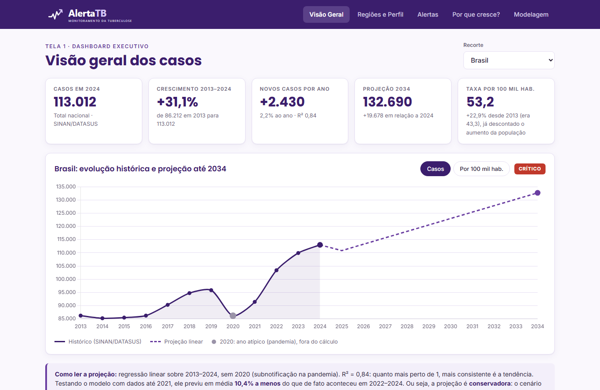
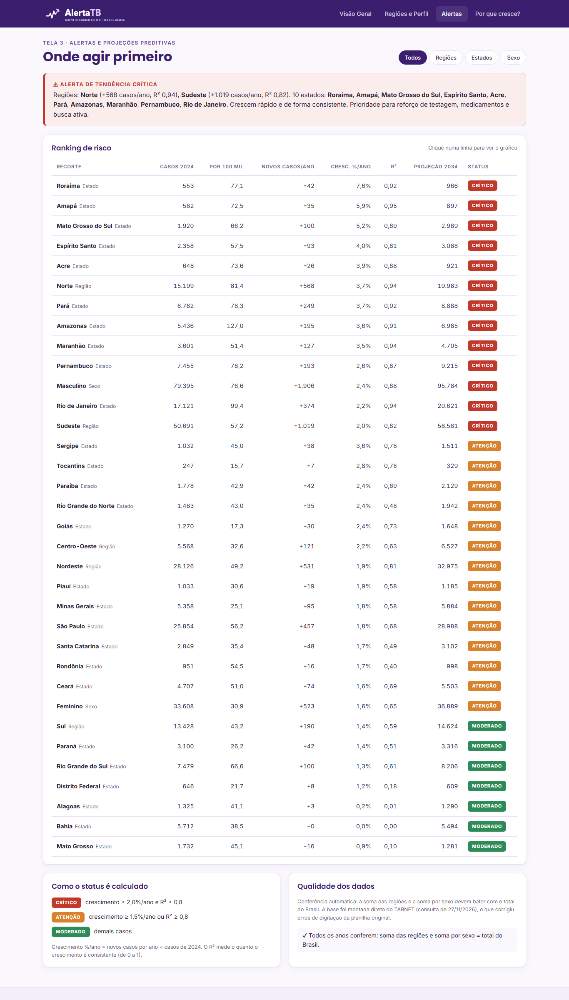

# AlertaTB — Painel Preditivo e Monitoramento Epidemiológico da Tuberculose no Brasil

> **FMU TECH Inovação — 1ª Edição 2026.2** · Desafio **ODS 3 – Saúde e Bem-Estar**
> Equipe **TechCare Analytics** (Squad M2SV2) · Centro Universitário FMU | FIAM-FAAM — Escola TECH (FMU Level UP)

<!-- TODO (identidade visual): inserir o logo do projeto aqui -->
<!--  -->

---

## 📌 Sobre o projeto

### O problema
A tuberculose continua sendo um dos principais desafios de saúde pública no Brasil. Entre **2013 e 2024**, os casos notificados subiram de **85.212** para **111.521**, um crescimento de **30,9%**. A única queda foi em 2020 (86.236 casos), ligada à subnotificação durante a pandemia de Covid-19.

Os dados são públicos (SINAN/DATASUS), mas ficam espalhados em tabelas estáticas. Isso dificulta que gestores vejam rápido as tendências regionais e demográficas. Em 2024:
- o **Sudeste** concentrou **45,1%** dos casos (São Paulo **22,7%** e Rio de Janeiro **15,4%**);
- o público **masculino** representou **70,1%** das notificações.

### Público-alvo
- **Gestores de Secretarias de Saúde** (municipais e estaduais): orçamento, compra de medicamentos e testes.
- **Coordenadores de Vigilância Epidemiológica**: monitoramento de surtos e busca ativa.
- **Pesquisadores e formuladores de políticas públicas**: recortes geográficos e demográficos confiáveis.

### A solução
O **AlertaTB** é um **dashboard web analítico e preditivo**. Ele transforma a base bruta do SINAN/DATASUS em visualizações interativas e usa **Regressão Linear** para projetar os casos de **2025 a 2034**. A projeção indica **+2.279 casos/ano**, chegando a **129.157 casos em 2034** se o cenário atual se mantiver. O painel tem filtros dinâmicos e alertas visuais para as regiões com crescimento mais rápido e consistente.

### Alinhamento ao ODS 3
Meta **3.3** da ONU: acabar com epidemias de doenças transmissíveis como a tuberculose. O projeto ajuda a antecipar surtos regionais, direcionar campanhas por perfil demográfico, otimizar recursos do SUS e interromper a cadeia de transmissão.

---

## 📊 Base de dados

| Item | Descrição |
|---|---|
| Fonte | **SINAN** (Sistema de Informação de Agravos de Notificação) via **DATASUS** — Ministério da Saúde |
| Período | 2013 a 2024 (12 anos) |
| Recortes | Brasil · 5 macrorregiões · São Paulo · Rio de Janeiro · Sexo (M/F) |

Arquivos em [`data/`](data/):
- [`data/raw/Analise_Tuberculose.xlsx`](data/raw/Analise_Tuberculose.xlsx): planilha original com estatística descritiva, correlação, regressões e projeções.
- [`data/processed/tuberculose_2013_2024.csv`](data/processed/tuberculose_2013_2024.csv): série histórica limpa.
- [`data/processed/projecao_2025_2034.csv`](data/processed/projecao_2025_2034.csv): projeção linear.

### Principais indicadores

| Recorte | Casos 2024 | Crescimento/ano | R² | Projeção 2034 |
|---|---:|---:|---:|---:|
| **Brasil** | **111.521** | **+2.279** | **0,73** | **129.157** |
| Norte | 15.065 | +548 | 0,89 | 19.544 |
| Nordeste | 27.559 | +476 | 0,64 | 31.831 |
| Centro-Oeste | 5.491 | +111 | 0,54 | 6.313 |
| Sul | 13.145 | +160 | 0,42 | 14.013 |
| Sudeste | 50.261 | +1.015 | 0,72 | 57.844 |
| São Paulo | 25.318 | +398 | 0,53 | 27.760 |
| Rio de Janeiro | 17.228 | +361 | 0,83 | 20.303 |
| Masculino | 78.208 | +1.771 | 0,78 | 92.930 |
| Feminino | 33.301 | +501 | 0,54 | 36.130 |

---

## 🛠️ Tecnologias

| Camada | Tecnologias | Papel |
|---|---|---|
| Tratamento e modelagem estatística | Python (Pandas, NumPy, Scikit-learn) | Limpeza da base, estatística descritiva, correlação e regressão linear |
| Visualização (BI) | Microsoft Power BI | Painéis interativos com filtros por região, estado e sexo |
| Interface web (portal) | HTML5, CSS3, JavaScript | Portal do painel, relatórios executivos e alertas de tendência |
| Versionamento e prototipação | Git, GitHub, Draw.io / Canva | Controle de versão, documentação e wireframes |

---

## 🖥️ Telas do protótipo

1. **Visão Geral (Dashboard Executivo):** KPIs (casos 2024, crescimento 2013–2024, projeção 2034), gráfico histórico + projeção e filtros.
2. **Análise Regional e Demográfica:** casos por macrorregião, distribuição por sexo, destaques de SP e RJ.
3. **Alertas e Projeções Preditivas:** banner de alerta crítico e tabela de risco com selos *Crítico / Atenção / Moderado*.

<!-- TODO (Checkpoint 2): adicionar prints do protótipo funcionando -->
<!--  -->
<!--  -->
<!--  -->

---

## ▶️ Como executar

> ⚠️ **Em construção:** os comandos abaixo serão confirmados quando o código for adicionado.

```bash
# 1. Clonar o repositório
git clone https://github.com/<usuario>/<repositorio>.git
cd <repositorio>

# 2. Análise de dados (Python 3.10+)
pip install -r analysis/requirements.txt
python analysis/<script_principal>.py

# 3. Portal web
# Abrir web/index.html no navegador (ou usar a extensão Live Server do VS Code)
```

🎥 **Vídeo de demonstração (até 3 min):** _link a ser adicionado_

---

## 📁 Estrutura do repositório

```
├── analysis/          # Scripts Python: tratamento, estatística e regressão
├── assets/
│   ├── identidade-visual/   # Logo, paleta de cores, tipografia
│   └── prints/              # Capturas de tela do protótipo
├── data/
│   ├── raw/           # Dados originais (SINAN/DATASUS)
│   └── processed/     # Dados tratados usados pelo painel
├── docs/
│   ├── edital/        # Regulamento do FMU TECH Inovação
│   ├── checkpoint1/   # Entrega do Checkpoint 1 (Ideação)
│   ├── checkpoint2/   # Checklist do Checkpoint 2 (Protótipo)
│   ├── checkpoint3/   # Material do pitch / banca
│   └── divisao_de_tarefas.md
├── powerbi/           # Arquivo .pbix e exportações do Power BI
└── web/               # Portal HTML/CSS/JS do AlertaTB
```

---

## 🗓️ Roadmap

| Etapa | Período | Entregáveis | Status |
|---|---|---|---|
| Checkpoint 1: Ideação | 19/10 a 30/10 | Problema, base de dados, análise exploratória, stack, wireframes | ✅ Entregue |
| Checkpoint 2: Protótipo | 09/11 a **27/11** | Protótipo funcional, README completo, prints, vídeo de até 3 min | 🚧 Em andamento |
| Banca avaliadora | **07 e 08/12/2026** | Pitch de 5 min + demonstração ao vivo | ⏳ |

---

## 👥 Equipe — TechCare Analytics

| Integrante | Responsabilidade principal |
|---|---|
| Mateus Figueiró | _ver [divisão de tarefas](docs/divisao_de_tarefas.md)_ |
| Mateus | _ver [divisão de tarefas](docs/divisao_de_tarefas.md)_ |
| Sindclay | _ver [divisão de tarefas](docs/divisao_de_tarefas.md)_ |
| Vinicius Cotrim | _ver [divisão de tarefas](docs/divisao_de_tarefas.md)_ |
| Vinicius Eiji | _ver [divisão de tarefas](docs/divisao_de_tarefas.md)_ |

Como contribuir: veja [CONTRIBUTING.md](CONTRIBUTING.md).

---

<sub>Fonte dos dados: SINAN/DATASUS — Ministério da Saúde. Projeto acadêmico desenvolvido para o FMU TECH Inovação 2026.2.</sub>
