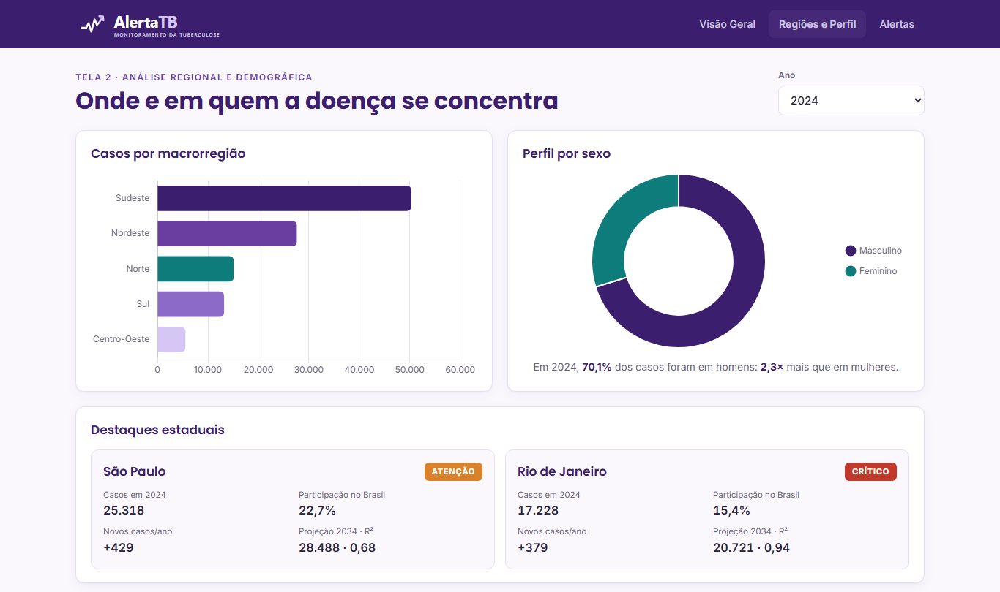

# AlertaTB — Painel Preditivo e Monitoramento Epidemiológico da Tuberculose no Brasil

> **FMU TECH Inovação — 1ª Edição 2026.2** · Desafio **ODS 3 – Saúde e Bem-Estar**
> Equipe **TechCare Analytics** (Squad M2SV2) · Centro Universitário FMU | FIAM-FAAM — Escola TECH (FMU Level UP)

<p align="center">
  
</p>

<p align="center">
  <a href="https://mateusmellomaia12-cloud.github.io/alertatb/"><strong>🌐 Acessar o painel online</strong></a>
</p>

---

## 🎤 Pitch

Todo ano, **mais de 110 mil brasileiros** são diagnosticados com tuberculose, uma doença que tem tratamento e cura, mas que voltou a crescer: **+30,9% entre 2013 e 2024**. Os dados para agir já existem e são públicos, mas ficam presos em planilhas do DATASUS que poucos gestores têm tempo de analisar. O resultado é um sistema de saúde que reage ao problema depois que ele aparece.

O **AlertaTB** transforma essas planilhas num painel que mostra, em segundos, **onde a doença cresce mais rápido** e **quantos casos esperar nos próximos dez anos**. Assim, as secretarias de saúde podem comprar testes e medicamentos, reforçar equipes e direcionar campanhas **antes** do pico.

### Nosso diferencial
- **Prevê, não só descreve:** além do histórico, projeta os casos de 2025 a 2034 por região, estado e sexo.
- **Alerta automático:** cada região recebe um selo (🔴 Crítico, 🟠 Atenção, 🟢 Moderado) calculado pela velocidade **e** pela consistência do crescimento, não por opinião.
- **Transparência estatística:** o painel mostra o R² e o erro do modelo testado com dados reais, para o gestor saber quanto pode confiar em cada projeção.
- **Dados 100% públicos e oficiais** (SINAN/DATASUS), com cálculo reproduzível em Python aberto neste repositório.
- **Feito para quem decide:** leitura em segundos, sem precisar entender estatística.

---

## 📌 Sobre o projeto

### O problema
A tuberculose continua sendo um dos principais desafios de saúde pública no Brasil. Entre **2013 e 2024**, os casos notificados subiram de **85.212** para **111.521**, um crescimento de **30,9%**. A única queda foi em 2020 (86.236 casos), ligada à subnotificação durante a pandemia de Covid-19.

Os dados são públicos (SINAN/DATASUS), mas ficam espalhados em tabelas estáticas. Isso dificulta que gestores vejam rápido as tendências regionais e demográficas. Em 2024:
- o **Sudeste** concentrou **45,1%** dos casos (São Paulo **22,7%** e Rio de Janeiro **15,4%**);
- o público **masculino** representou **70,1%** das notificações.

### Público-alvo
- **Gestores de Secretarias de Saúde** (municipais e estaduais): orçamento, compra de medicamentos e testes.
- **Coordenadores de Vigilância Epidemiológica**: monitoramento de surtos e busca ativa.
- **Pesquisadores e formuladores de políticas públicas**: recortes geográficos e demográficos confiáveis.

### A solução
O **AlertaTB** é um **dashboard web analítico e preditivo**. Ele transforma a base bruta do SINAN/DATASUS em visualizações interativas e usa **Regressão Linear** para projetar os casos de **2025 a 2034**. A projeção indica **+2.279 casos/ano**, chegando a **129.157 casos em 2034** se o cenário atual se mantiver. O painel tem filtros dinâmicos e alertas visuais para as regiões com crescimento mais rápido e consistente.

### Alinhamento ao ODS 3
Meta **3.3** da ONU: acabar com epidemias de doenças transmissíveis como a tuberculose. O projeto ajuda a antecipar surtos regionais, direcionar campanhas por perfil demográfico, otimizar recursos do SUS e interromper a cadeia de transmissão.

---

## 📊 Base de dados

| Item | Descrição |
|---|---|
| Fonte | **SINAN** (Sistema de Informação de Agravos de Notificação) via **DATASUS** — Ministério da Saúde |
| Período | 2013 a 2024 (12 anos) |
| Recortes | Brasil · 5 macrorregiões · São Paulo · Rio de Janeiro · Sexo (M/F) |

Arquivos em [`data/`](data/):
- [`data/raw/Analise_Tuberculose.xlsx`](data/raw/Analise_Tuberculose.xlsx): planilha original com estatística descritiva, correlação, regressões e projeções.
- [`data/processed/tuberculose_2013_2024.csv`](data/processed/tuberculose_2013_2024.csv): série histórica limpa.
- [`data/processed/projecao_2025_2034.csv`](data/processed/projecao_2025_2034.csv): projeção linear original da planilha.
- [`data/processed/dados_painel.json`](data/processed/dados_painel.json): gerado por [`analysis/regressao.py`](analysis/regressao.py), usado pelo portal web.

📋 **Avaliação da base, problemas encontrados e próximos passos:** [docs/avaliacao_da_base.md](docs/avaliacao_da_base.md)

### Principais indicadores

| Recorte | Casos 2024 | Crescimento/ano | R² | Projeção 2034 |
|---|---:|---:|---:|---:|
| **Brasil** | **111.521** | **+2.279** | **0,73** | **129.157** |
| Norte | 15.065 | +548 | 0,89 | 19.544 |
| Nordeste | 27.559 | +476 | 0,64 | 31.831 |
| Centro-Oeste | 5.491 | +111 | 0,54 | 6.313 |
| Sul | 13.145 | +160 | 0,42 | 14.013 |
| Sudeste | 50.261 | +1.015 | 0,72 | 57.844 |
| São Paulo | 25.318 | +398 | 0,53 | 27.760 |
| Rio de Janeiro | 17.228 | +361 | 0,83 | 20.303 |
| Masculino | 78.208 | +1.771 | 0,78 | 92.930 |
| Feminino | 33.301 | +501 | 0,54 | 36.130 |

---

## 🛠️ Tecnologias

| Camada | Tecnologias | Papel |
|---|---|---|
| Tratamento e modelagem estatística | Python (Pandas, NumPy, Scikit-learn) | Regressão linear por recorte, backtest, projeção 2025–2034 e selos de alerta ([`analysis/regressao.py`](analysis/regressao.py)) |
| Interface web (painel) | HTML5, CSS3, JavaScript + [Chart.js](https://www.chartjs.org/) | As 3 telas do AlertaTB, com filtros, gráficos e ranking de risco ([`web/`](web/)) |
| Hospedagem | GitHub Pages | Painel publicado online, acessível de qualquer navegador |
| Visualização (BI) | Microsoft Power BI | Painéis complementares *(em avaliação pelo grupo)* |
| Versionamento e prototipação | Git, GitHub, Draw.io / Canva | Controle de versão, documentação e wireframes |
| Identidade visual | Poppins + Inter, paleta roxa | Guia em [`assets/identidade-visual/`](assets/identidade-visual/) |

**Por que essas escolhas:**
- **Python + Scikit-learn:** padrão de mercado para análise de dados; o cálculo fica reproduzível e auditável, sem números copiados à mão.
- **Site em HTML/CSS/JS puro:** roda em qualquer navegador, sem instalar nada e sem licença. O gestor de saúde só precisa de um link.
- **Chart.js:** biblioteca leve e gratuita para gráficos interativos (tooltips, filtros).
- **GitHub Pages:** hospedagem gratuita no próprio repositório; cada atualização do código atualiza o site.

**Como os dados chegam ao painel:**
```
data/processed/tuberculose_2013_2024.csv  (SINAN/DATASUS)
        │
        ▼  python analysis/regressao.py
data/processed/dados_painel.json  +  web/js/dados.js
        │
        ▼  lido pelo navegador
web/index.html  →  Visão Geral · Regiões e Perfil · Alertas
```

---

## 🖥️ Telas do protótipo

**Fluxo principal:** o gestor abre o painel, vê os indicadores do Brasil, filtra por região, estado ou sexo e vê o gráfico atualizar. Na tela de Alertas, encontra as regiões que exigem ação e, com um clique, abre o gráfico daquela região.

### 1. Visão Geral (Dashboard Executivo)
Filtro por recorte, 4 indicadores (casos 2024, crescimento 2013–2024, novos casos por ano, projeção 2034), gráfico do histórico com a projeção tracejada e uma nota explicando como ler o modelo.


### 2. Regiões e Perfil
Filtro por ano (2013–2024), casos por macrorregião, distribuição por sexo e destaques de São Paulo e Rio de Janeiro.



### 3. Alertas e Projeções Preditivas
Alerta de tendência crítica, ranking de risco com selos *Crítico / Atenção / Moderado* (filtrável por regiões, estados e sexo), regra de cálculo e transparência sobre a qualidade dos dados.


---

## ▶️ Como executar

### Opção 1: online (mais fácil)
Acesse **https://mateusmellomaia12-cloud.github.io/alertatb/**. Não precisa instalar nada.

### Opção 2: no seu computador
```bash
# 1. Clonar o repositório
git clone https://github.com/mateusmellomaia12-cloud/alertatb.git
cd alertatb

# 2. Abrir o painel: basta dar dois cliques em web/index.html
#    (precisa de internet para carregar as fontes e a biblioteca de gráficos)
```

### Opção 3: recalcular os dados (Python 3.10+)
Só é necessário se a base em `data/processed/tuberculose_2013_2024.csv` for alterada.
```bash
pip install -r analysis/requirements.txt
python analysis/regressao.py
# gera data/processed/dados_painel.json e web/js/dados.js
# depois é só recarregar o web/index.html no navegador
```

🎥 **Vídeo de demonstração (até 3 min):** _link a ser adicionado_

---

## 📁 Estrutura do repositório

```
├── analysis/          # Scripts Python: tratamento, estatística e regressão
├── assets/
│   ├── identidade-visual/   # Logo, paleta de cores, tipografia
│   └── prints/              # Capturas de tela do protótipo
├── data/
│   ├── raw/           # Dados originais (SINAN/DATASUS)
│   └── processed/     # Dados tratados usados pelo painel
├── docs/
│   ├── edital/        # Regulamento do FMU TECH Inovação
│   ├── checkpoint1/   # Entrega do Checkpoint 1 (Ideação)
│   ├── checkpoint2/   # Checklist do Checkpoint 2 (Protótipo)
│   ├── checkpoint3/   # Material do pitch / banca
│   └── divisao_de_tarefas.md
├── powerbi/           # Arquivo .pbix e exportações do Power BI
├── web/               # Painel AlertaTB (index.html, css/, js/, img/)
└── index.html         # Redireciona o GitHub Pages para web/
```

---

## 🗓️ Roadmap

| Etapa | Período | Entregáveis | Status |
|---|---|---|---|
| Checkpoint 1: Ideação | 19/10 a 30/10 | Problema, base de dados, análise exploratória, stack, wireframes | ✅ Entregue |
| Checkpoint 2: Protótipo | 09/11 a **27/11** | Protótipo funcional, README completo, prints, vídeo de até 3 min | 🚧 Em andamento |
| Banca avaliadora | **07 e 08/12/2026** | Pitch de 5 min + demonstração ao vivo | ⏳ |

---

## 👥 Equipe — TechCare Analytics

| Integrante | Responsabilidade principal |
|---|---|
| Mateus Figueiró | _ver [divisão de tarefas](docs/divisao_de_tarefas.md)_ |
| Mateus | _ver [divisão de tarefas](docs/divisao_de_tarefas.md)_ |
| Sindclay | _ver [divisão de tarefas](docs/divisao_de_tarefas.md)_ |
| Vinicius Cotrim | _ver [divisão de tarefas](docs/divisao_de_tarefas.md)_ |
| Vinicius Eiji | _ver [divisão de tarefas](docs/divisao_de_tarefas.md)_ |

Como contribuir: veja [CONTRIBUTING.md](CONTRIBUTING.md).

---

<sub>Fonte dos dados: SINAN/DATASUS — Ministério da Saúde. Projeto acadêmico desenvolvido para o FMU TECH Inovação 2026.2.</sub>
